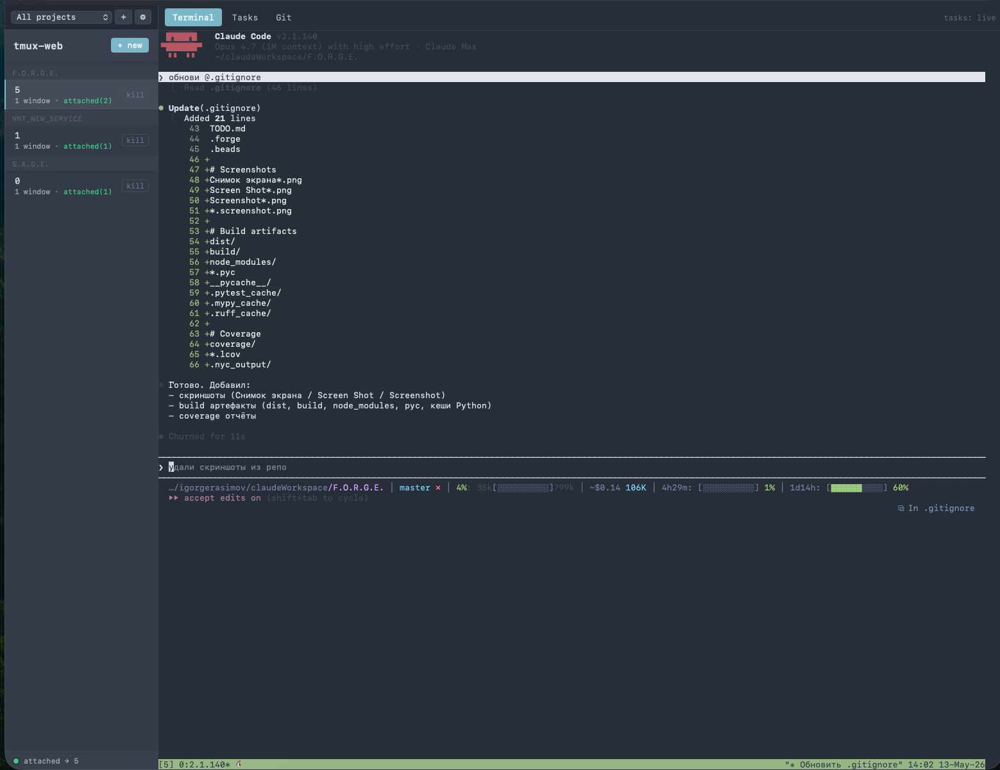
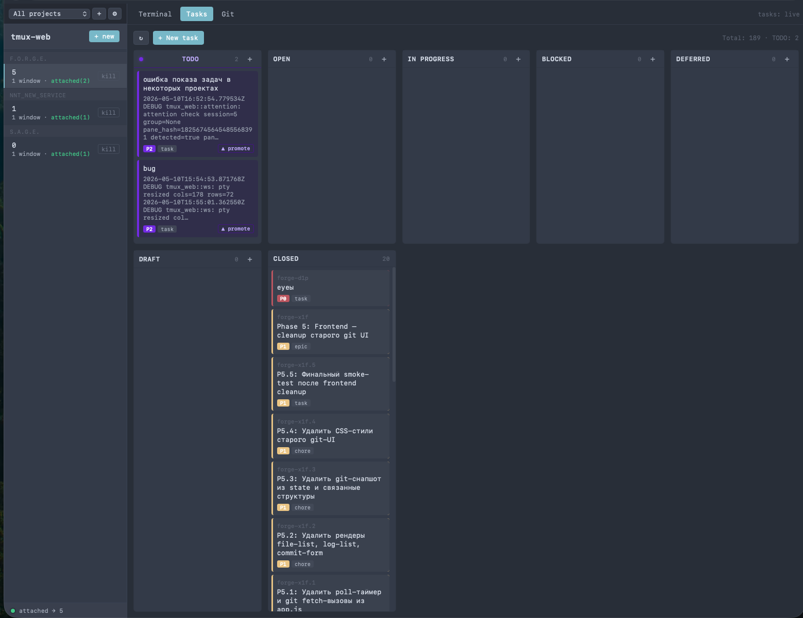
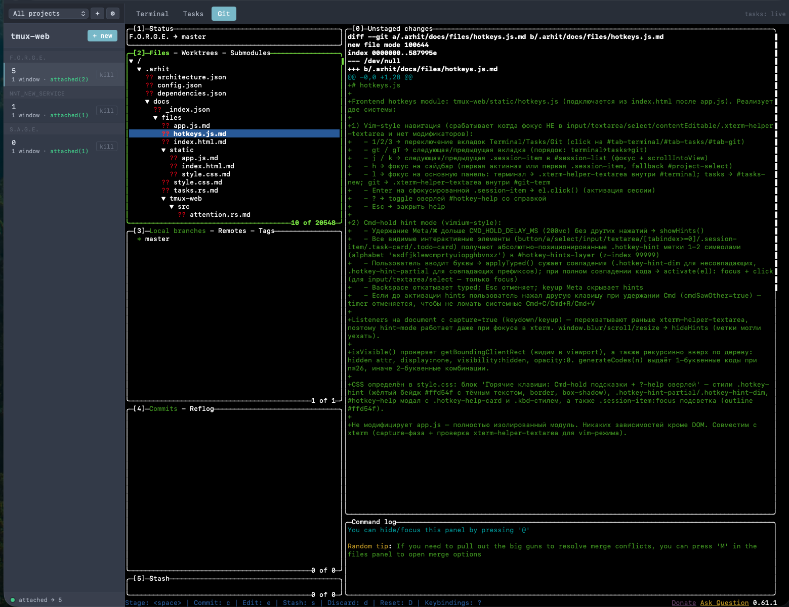
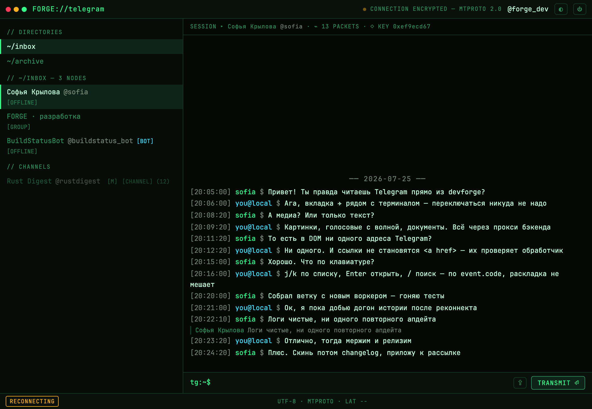
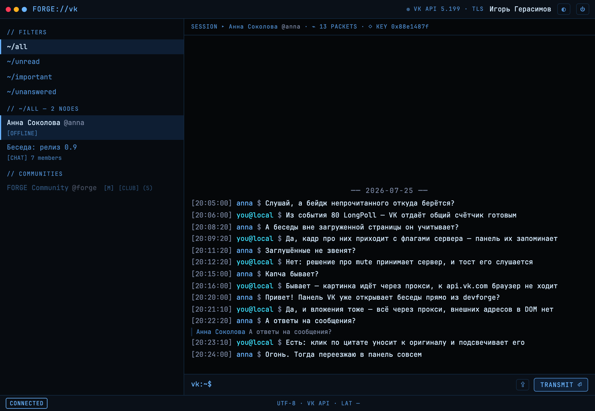
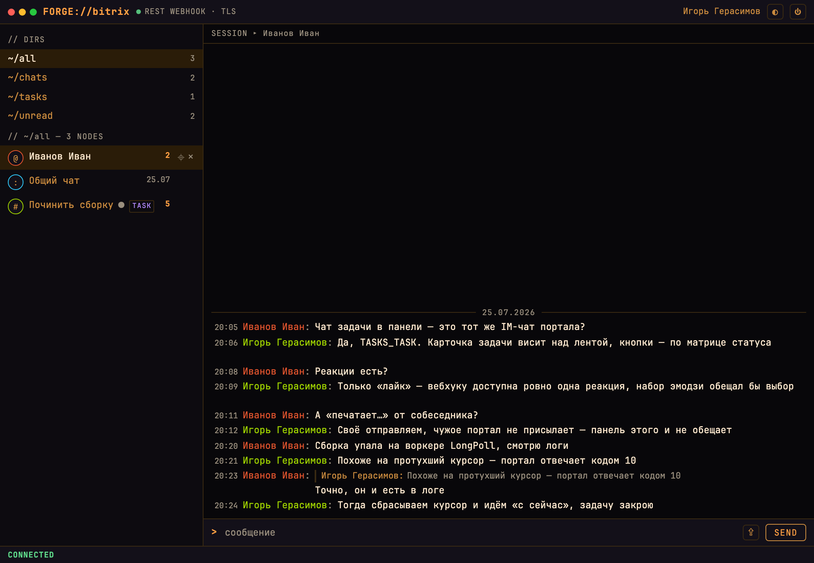

<div align="center">


<h1 align="center">F.O.R.G.E.</h1>

<p align="center"><em>Flow Orchestration and Real-time Governance Engine</em></p>

<p align="center"><strong>Веб-кокпит для разработчика: tmux + канбан + git + AI-агенты в одном окне.</strong></p>

<p align="center">
  <a href="https://www.rust-lang.org"></a>
  <a href="https://github.com/tokio-rs/axum"></a>
  <a href="https://xtermjs.org"></a>
  <a href="https://docs.anthropic.com/en/docs/claude-code"></a>
  <a href="LICENSE"></a>
  
</p>

<p align="center">
  <a href="https://github.com/darkClaw921/F.O.R.G.E./releases/latest"></a>
  <a href="https://github.com/darkClaw921/F.O.R.G.E./releases"></a>
  <a href="https://github.com/darkClaw921/F.O.R.G.E."></a>
  <a href="https://github.com/darkClaw921/F.O.R.G.E./stargazers"></a>
  <a href="https://aur.archlinux.org/packages/devforge"></a>
  <a href="https://aur.archlinux.org/packages/devforge"></a>
</p>

<p align="center">
  <a href="#-возможности">Возможности</a> ·
  <a href="#-архитектура">Архитектура</a> ·
  <a href="#-быстрый-старт">Старт</a> ·
  <a href="#-claude-code-интеграция">Claude</a> ·
  <a href="#-rest-api">API</a>
</p>

</div>

---

## 📜 Что это

**F.O.R.G.E.** — единый рабочий стол для разработчика, который держит в одной вкладке браузера всё, ради чего раньше держал четыре терминала и три приложения:

- живые **tmux-сессии** через WebSocket + xterm.js,
- **канбан-доски** на базе [beads_rust](https://github.com/Dicklesworthstone/beads_rust),
- **lazygit**, **lazydocker** и **television** (fuzzy-finder) — каждый в своей браузерной вкладке,
- **TODO**-конвейер, прокидывающий задачи прямо в tmux-сессию,
- **AI-агенты** Claude Code (декомпозиция плана, выполнение фаз, трекинг времени),
- **мессенджеры** — Telegram, VK и Битрикс24 отдельными вкладками (opt-in плагины),
- мульти-проектность, темы, нотификации.

Один Rust-бинарь, без Node, без Docker.

---

## 🖼️ Скриншоты

<div align="center">

<table>
  <tr>
    <td align="center" width="50%">
      
      <br/>
      <sub><b>🖥️ Terminal</b> — tmux-сессии через xterm.js + WebSocket</sub>
    </td>
    <td align="center" width="50%">
      
      <br/>
      <sub><b>📋 Tasks</b> — канбан-доска на beads_rust с live-стримом</sub>
    </td>
  </tr>
  <tr>
    <td colspan="2" align="center">
      
      <br/>
      <sub><b>🌿 Git</b> — встроенный lazygit через PTY/WebSocket</sub>
    </td>
  </tr>
  <tr>
    <td align="center" width="50%">
      
      <br/>
      <sub><b>✈ Telegram</b> — личный аккаунт по MTProto (плагин, флаг <code>--telegram</code>)</sub>
    </td>
    <td align="center" width="50%">
      
      <br/>
      <sub><b>Ⓥ VK</b> — VK API + LongPoll (плагин, флаг <code>--vk</code>)</sub>
    </td>
  </tr>
  <tr>
    <td colspan="2" align="center">
      
      <br/>
      <sub><b>Ⓑ Битрикс24</b> — портал по входящему вебхуку, чаты и чаты задач (плагин, флаг <code>--bitrix</code>)</sub>
    </td>
  </tr>
</table>

</div>

> Кадры мессенджеров сняты на **вымышленной** переписке: панели подняты на
> настоящих разметке, стилях и модулях, а ответы API подменены фикстурами. Живых
> аккаунтов в репозитории нет и не будет. Подробности про плагины — в разделе
> [«Плагины-мессенджеры»](#-плагины-мессенджеры-telegram--vk--битрикс24).

---

## ✨ Возможности

### 🖥️ Terminal & tmux

- **Полноценный tmux в браузере** — xterm.js + WebSocket-bridge, `xterm-256color`, true-color.
- **Список сессий** в реальном времени: имя, окна, клиенты, время создания.
- **Создание / удаление / hot-switch** сессий без перезагрузки страницы.
- **Авто-resize PTY** при изменении размера окна.
- **Выбор папки запуска** новой tmux-сессии (произвольный cwd).
- Один бинарь, рантайм-зависимость только `tmux`.

### 📋 Tasks (Kanban на beads)

- Канбан-доска на каждый проект, статусы из `br` (beads).
- WebSocket-стрим `/ws/tasks` — изменения в `.beads/issues.jsonl` прилетают в UI мгновенно (file-watcher через `notify`).
- Создание / закрытие / reopen / patch — прямо из UI, ходит через REST в `br`.
- Приоритеты P0–P4, типы (task / bug / feature / epic / chore / docs / question), зависимости.

### ✅ TODO-конвейер

- Стадии: **inbox → нужно сделать → сделано**.
- Промоут TODO → tmux-сессия: при переводе задачи в активную стадию текст уходит **в нужную tmux-сессию проекта** как промпт.
- Настройка отправки: сразу или после завершения предыдущей TODO в этом проекте.
- WebSocket-стрим `/ws/todos`.

### 🧰 TUI-табы (lazygit / lazydocker / television)

Три вкладки, построенные на общем фреймворке `createTuiTab`: отдельный `xterm.js`-инстанс в браузере, отдельный WebSocket на сервере, PTY-процесс работает в cwd активного проекта. Переключение проекта прозрачно дёргает `switch_cwd` (kill old → spawn new в новом каталоге, тот же WS).

- 🌿 **Git** — встроенный [`lazygit`](https://github.com/jesseduffield/lazygit) (`/ws/lazygit`).
- 🐳 **Docker** — встроенный [`lazydocker`](https://github.com/jesseduffield/lazydocker) (`/ws/lazydocker`).
- 🔭 **Find** — встроенный [`television`](https://github.com/alexpasmantier/television) (`tv`), fuzzy-finder в духе telescope.nvim (`/ws/telescope`). Над терминалом — переключатель каналов **`Files / Content / Dirs / Git log`** (Files = по именам через fd, Content = по содержимому через ripgrep, Dirs = по каталогам, Git log = по коммитам). Клик по кнопке — мгновенный reconnect с новым каналом. Требует helpers `fd` + `bat` + `rg` — ставятся одной командой `brew install television fd bat ripgrep`.

Каждая вкладка:

- автодетектит установку бинаря и показывает install-banner с командами для macOS/Linux при отсутствии,
- поддерживает retry + ResizeObserver + Binary-frame stdin (контракт идентичен `/ws/attach`),
- работает в remote-режиме через generic `remote_proxy` — `?server=<id>` прозрачно проксируется на upstream-сервер по тому же пути.

**Копирование текста из preview-панели:** TUI-программы (tv/lazygit/lazydocker) захватывают мышь, поэтому обычное выделение не работает. Используй стандартный xterm.js-bypass:

- macOS: `⌥ Option + drag` для selection → `⌘ Cmd + C` для копирования
- Linux/Windows: `Shift + drag` для selection → `Ctrl + Shift + C` для копирования

### 📁 cwd-only модель

- Источник истины — cwd сессии: TODO, beads-таски, notifier — всё резолвится по cwd.
- Группировка в sidebar — только folder-headers (никаких project-разделов).
- «Корень» для TODO/notifier ищется через `paths::resolve_root(cwd)`: первая папка вверх с `.beads/` → затем с `.git/` → fallback на сам cwd.
- Глобальное хранилище: `~/.config/forge/todos.json`, `~/.config/forge/notifier.json` (один на пользователя).

### 🎨 Темы (9 пресетов + custom)

`Default · Dracula · Solarized Dark · Solarized Light · Monokai · Nord · Gruvbox Dark · One Dark · Tokyo Night`

- Единая модель `Theme { ui, term }` — красит и UI, и xterm.js.
- Пользовательские темы (CRUD `/api/themes/custom`), атомарное сохранение в `themes.json`.

### 🔔 Notifications & Attention

- `attention.rs` — детектор «требует внимания» в tmux-сессии (ANSI bell, кастомные триггеры).
- `notifier.rs` — нотификации promote TODO → bd-task через `tmux send-keys`. Глобальный конфиг в `~/.config/forge/notifier.json` (`notifier_config.rs`, REST `/api/notifier-config`).
- Состояние pending-jobs: `~/.config/forge/notify_state.json`.

### ⌨️ UX

- Vim-style hotkeys + Cmd-hint mode (`hotkeys.js`).
- Sidebar + табы (Terminal / Tasks / Git / Docker / Find), полностью клавиатурный воркфлоу.
- Status-dot WS-соединения, авто-reconnect.

### 💬 Мессенджеры (opt-in)

- **Telegram** (`--telegram`), **VK** (`--vk`), **Битрикс24** (`--bitrix`) — три
  отдельные вкладки: переписка рядом с терминалом, без второго окна.
- Медиа и аватары только через прокси бэкенда — внешних адресов в DOM нет.
- Белый список чатов, бейдж непрочитанного, тосты, своя тема и хоткеи у каждой панели.
- Подробности, ограничения платформ и скриншоты — в разделе
  [«Плагины-мессенджеры»](#-плагины-мессенджеры-telegram--vk--битрикс24).

---

## 💬 Плагины-мессенджеры (Telegram · VK · Битрикс24)

Три отдельные вкладки рядом с терминалом: переписка не выкидывает вас из рабочего
места и не требует второго окна. Каждый плагин **opt-in** — без своего флага он не
поднимает ни роутов, ни воркеров, а кнопка вкладки остаётся скрытой:

```bash
devforge --telegram          # вкладка ✈  Telegram (личный аккаунт, MTProto)
devforge --vk                # вкладка Ⓥ  VK (личный аккаунт, VK API 5.199)
devforge --bitrix            # вкладка Ⓑ  Битрикс24 (портал, входящий вебхук)
devforge --telegram --vk --bitrix   # все три сразу
```

### Что общего у всех трёх

- **Ни одного внешнего адреса в DOM.** Аватары, картинки, документы, голосовые и
  даже картинка капчи идут через прокси бэкенда: браузер не ходит ни в Telegram,
  ни в `api.vk.com`, ни на CDN портала.
- **`innerHTML` запрещён полностью.** Текст собеседника собирается узлами
  (`createElement`/`textContent`), ссылки НЕ становятся `<a href>` — адрес прислал
  чужой человек, и переход по нему делает обработчик, проверяющий схему.
- **Секреты не задерживаются во фронте.** Токен, код входа и URL вебхука уходят на
  бэкенд и в DOM не возвращаются; поля ввода — `password`.
- **Realtime своим WebSocket** (`/ws/telegram`, `/ws/vk`, `/ws/bitrix`): новые
  сообщения, правки, удаления, отметки о прочтении, счётчики. Соединение
  постоянное — бейдж непрочитанного работает, пока вы сидите в терминале.
- **Белый список чатов**: в настройках можно оставить только рабочие диалоги —
  фильтр действует и на колонку, и на счётчики, и на бейдж, и на тосты.
- **Своя тема панели** (авто / тёмная / светлая) и свои горячие клавиши по
  `event.code` — русская раскладка не ломает `j`/`k`.
- **Панели взаимоисключающи**: открытая скрывает две другие, и сообщение не уходит
  «не в тот мессенджер».

### ✈ Telegram

Личный аккаунт по **MTProto** ([grammers](https://github.com/Lonami/grammers)), вход
по номеру телефона + код + 2FA, сессия хранится файлом на сервере.

- Директории `~/inbox` и `~/archive`, отдельная секция каналов; группы, боты, mute.
- Лента: история постранично, отправка, правка, удаление, **ответы** — клик по
  цитате уносит к оригиналу и подсвечивает его.
- Медиа: картинки, документы, **голосовые с волной**, ленивая подгрузка превью.
- Клавиатуры ботов (inline и reply), `callback`-кнопки.
- Присутствие: «печатает…», online/был в сети, отметки о прочтении.
- Отправка файлов тремя путями: кнопка ⇪, drag & drop, `Ctrl+V`.

### Ⓥ VK

Личный аккаунт по **VK API 5.199** с пользовательским токеном; события — серверный
**LongPoll**-воркер, фронт о нём не знает.

- Четыре **серверных** фильтра: `~/all`, `~/unread`, `~/important`, `~/unanswered`.
- Бюджет платформы **3 запроса в секунду** держит планировщик: запросы
  приоритизируются и коалесцируются, «прощёлкать десять бесед» не стоит десяти историй.
- Ответы адресуются `conversation_message_id`, пересылки разворачиваются деревом,
  до 10 вложений на сообщение, клавиатуры сообществ.
- Общий счётчик непрочитанного приходит от VK готовым (событие 80) и имеет приоритет
  над локальной суммой по загруженной странице.
- **Капча** решается в панели: картинка идёт через прокси, прямой адрес VK игнорируется.
- Догон истории после фона и обрыва связи: пропущенные кадры дочитываются по REST,
  открытая беседа не остаётся устаревшей.

### Ⓑ Битрикс24

Портал по **входящему вебхуку** (REST + TLS). Вебхук выпускается от имени одного
сотрудника — все, кто откроет этот devforge, увидят его переписку; панель говорит
об этом прямо на экране подключения.

- Четыре директории одного списка — `~/all`, `~/chats`, `~/tasks`, `~/unread`.
  Нарезка **локальная**: портал отдаёт один список, сетевого запроса переключение не стоит.
- **Чаты задач** — первого класса: карточка задачи над лентой, кнопки строго по
  матрице статуса (после «Начать» появляется «Пауза»), счётчик новых комментариев.
- BB-коды портала (`[B] [URL] [USER] [QUOTE] [DISK] [TIMESTAMP]`) разбираются на
  сервере в структурные сегменты и рисуются узлами.
- Ответ уезжает и `REPLY_ID`, и **текстовой цитатой**: при чтении портал `REPLY_ID`
  не отражает, поэтому цитата — единственный след ответа. Клик по ней ищет оригинал
  и подсвечивает его.
- «Лайк» — единственная доступная вебхуку реакция, набор эмодзи обещал бы выбор,
  которого нет. Правка и удаление — только своих сообщений.
- Панель честна про ограничения платформы: чужое «печатает…», присутствие и
  realtime-правки портал не присылает, и панель их не изображает.

Как выглядят все три вкладки — см. [«Скриншоты»](#️-скриншоты) в начале README.

---

## 🧠 Claude Code-интеграция

Проект заточен под совместную работу с **Claude Code** (Anthropic CLI).

## 🏗️ Архитектура

```
┌──────────────────────────────────────────────────────────────────────┐
│  Browser (xterm.js + app.js + hotkeys.js)                            │
│  Terminal │ Tasks │ Git │ Docker │ Find │ Themes                     │
│  ✈ Telegram │ Ⓥ VK │ Ⓑ Bitrix24  (opt-in вкладки-мессенджеры)        │
└─────┬─────────────┬──────────────┬──────────────┬────────────────────┘
      │ WS /ws/attach              │ WS /ws/lazygit                    │
      │ WS /ws/lazydocker          │ WS /ws/telescope                  │
      │ WS /ws/tasks               │ WS /ws/todos                      │
      │ WS /ws/telegram /ws/vk /ws/bitrix  (кадры мессенджеров)         │
      │ (binary PTY / JSON events)                                     │
┌─────▼──────────────────────────────────────────────────────────────┐
│  Rust server (axum 0.7 + tokio)                                    │
│  REST: /api/sessions /api/tasks /api/todos /api/themes /api/notifier-config │
│                                                                    │
│  pty.rs ── portable-pty ── tmux attach / lazygit / lazydocker / tv │
│  ws.rs  ── generic handle_tui_socket<F> для всех TUI-табов        │
│  tasks.rs ── shells out to `br` (beads_rust)                       │
│  tasks_watcher.rs ── notify(6) ── .beads/issues.jsonl              │
│  paths.rs ── resolve_root(cwd): ближайший .beads/ → .git/ → cwd   │
│  todos.rs ── ~/.config/forge/todos.json (by root_path)            │
│  notifier.rs + notifier_config.rs ── send-keys + глобальный config │
│  themes.rs   ── 9 presets + custom (atomic write)                  │
│  attention.rs ── needs_attention/is_generating per session         │
│  remote_proxy.rs ── прозрачный WS-proxy на upstream-серверы       │
├────────────────────────────────────────────────────────────────────┤
│  Плагины (каждый — свой крейт workspace, включается флагом):       │
│  forge-telegram ── MTProto-клиент + updates-воркер                 │
│  forge-vk       ── VK API 5.199 + LongPoll-воркер (бюджет 3 rps)   │
│  forge-bitrix   ── REST-вебхук портала + пуллер (бюджет 2 rps)     │
│  forge-echo     ── чат-ассистент на Claude CLI (trait HostApi)     │
└────────────────────────────────────────────────────────────────────┘
```

| Модуль                               | Назначение                                                                                                                              |
| ------------------------------------------ | ------------------------------------------------------------------------------------------------------------------------------------------------- |
| `src/main.rs`                            | Axum-роутер, REST endpoints, статика, health-check.                                                                                  |
| `src/tmux.rs`                            | Обёртка над `tmux` CLI: list / new / kill.                                                                                            |
| `src/pty.rs`                             | `portable-pty` + `tmux attach` / `lazygit` / `lazydocker` / `tv` на одну WS-сессию.                                         |
| `src/ws.rs`                              | WebSocket-bridge: байты PTY ↔ браузер + control-сообщения. Generic `handle_tui_socket<F>` для всех TUI-табов. |
| `src/remote_proxy.rs`                    | Прозрачный WS-proxy для remote-режима (все `/ws/*` пути, включая TUI).                                         |
| `src/tasks.rs`                           | REST `/api/tasks`, дёргает `br`.                                                                                                       |
| `src/ws_tasks.rs` + `tasks_watcher.rs` | WS-стрим изменений `.beads/issues.jsonl`.                                                                                         |
| `src/todos.rs` + `ws_todos.rs`         | TODO-конвейер по cwd: `~/.config/forge/todos.json` сгруппирован по `root_path`; WS `?path=<cwd>` через `paths::resolve_root`. |
| `src/paths.rs`                           | `resolve_root(cwd)` — поиск корня (`.beads/` → `.git/` → cwd).                                                              |
| `src/notifier_config.rs`                 | Глобальный конфиг notifier (template/delay/wait_previous/session) в `~/.config/forge/notifier.json`. REST `/api/notifier-config`. |
| `src/themes.rs`                          | 9 пресетов + custom темы (глобально).                                                                                              |
| `src/attention.rs` + `notifier.rs`     | needs_attention/is_generating per session + send-keys нотификации.                                                          |
| `static/`                                | `index.html`, `app.js` (~4.5k), `style.css` (~2.2k), `hotkeys.js`, панели `js/{telegram,vk,bitrix}/`.                                     |
| `plugins/telegram/`                      | Плагин ✈ Telegram: MTProto через `grammers`, сессия файлом, воркер апдейтов, роуты `/api/telegram/*`, кадры `/ws/telegram`. Флаг `--telegram`. |
| `plugins/vk/`                            | Плагин Ⓥ VK: VK API 5.199, LongPoll-воркер с обогащением пачки одним запросом, планировщик 3 rps, роуты `/api/vk/*`. Флаг `--vk`.        |
| `plugins/bitrix/`                        | Плагин Ⓑ Битрикс24: входящий вебхук портала, разбор BB-кодов в сегменты, чаты задач, роуты `/api/bitrix/*`. Флаг `--bitrix`.             |

---

## 🚀 Быстрый старт

### 🍺 Установка через Homebrew (macOS)

Один self-contained бинарь `devforge` — статика (HTML/CSS/JS, xterm.js) встроена прямо в исполняемый файл через [rust-embed](https://crates.io/crates/rust-embed), отдельный каталог `static/` не нужен.

```bash
brew tap darkClaw921/tap
brew install devforge
devforge          # стартует на http://127.0.0.1:7331
```

> Если ранее уже подключали неправильный tap — отвяжите его:
> `brew untap darkClaw921/devforge 2>/dev/null || true`

### 🏛 Установка через AUR (Arch Linux / Manjaro / EndeavourOS)

Пакет: **[`devforge`](https://aur.archlinux.org/packages/devforge)** в AUR.

```bash
yay -S devforge          # или: paru -S devforge
devforge                 # стартует на http://127.0.0.1:7331
```

PKGBUILD собирает бинарь из исходников через `cargo build -p devforge --release --locked`.
Зависимости в рантайме — `tmux` (обязательно), опционально `lazygit` / `lazydocker` /
`television` / `fd` / `bat` / `ripgrep`. Подробности и локальная сборка пакета —
см. [`packaging/aur/devforge/README.md`](packaging/aur/devforge/README.md).
Релизы AUR обновляются автоматически из `release.sh`.

### 🎛 Команды и флаги

```bash
devforge                       # foreground на http://127.0.0.1:7331 (дефолт)
devforge run --port 8080       # foreground на кастомном порту
devforge start                 # запустить как daemon в фоне
devforge start --port 8080     # daemon на кастомном порту
devforge status                # показать состояние daemon (PID + порт)
devforge stop                  # остановить daemon (SIGTERM, fallback SIGKILL через 5s)
devforge --telegram --vk --bitrix   # включить вкладки мессенджеров (opt-in, по умолчанию выключены)
devforge --help                # полный список опций
```

| Команда        | Что делает                                                                                                                                           |
| --------------------- | ------------------------------------------------------------------------------------------------------------------------------------------------------------- |
| `run` *(default)* | Запускает сервер в foreground. Логи в stdout. Завершается по `Ctrl+C`.                                                    |
| `start [--port N]`  | Спавнит daemon через `setsid(2)`, PID пишется в `~/.config/forge/devforge.pid`, stdout/stderr — в `~/.config/forge/devforge.log`. |
| `stop`              | Читает PID, шлёт `SIGTERM`, ждёт до 5 секунд, при таймауте — `SIGKILL`.                                                 |
| `status`            | Печатает «running (PID …)» или «not running»; детектит stale pid-файлы после краша.                                    |

Опция `-p` / `--port <N>` (default `7331`) валидна для `run` и `start`. Сервер всегда биндится на `127.0.0.1` — наружу не торчит.

**Флаги плагинов** (валидны для `run` и `start`, по умолчанию выключены — без них поведение байт-в-байт как раньше):

| Флаг         | Что включает                                                                                     |
| ------------ | ------------------------------------------------------------------------------------------------ |
| `--telegram` | Вкладку ✈ Telegram: роуты `/api/telegram/*` и `/ws/telegram` (личный аккаунт по MTProto).          |
| `--vk`       | Вкладку Ⓥ VK: роуты `/api/vk/*` и `/ws/vk` (личный аккаунт по VK API + LongPoll-воркер).           |
| `--bitrix`   | Вкладку Ⓑ Битрикс24: роуты `/api/bitrix/*` и `/ws/bitrix` (портал по входящему вебхуку).           |

**Daemon-файлы** (создаются в `~/.config/forge/`):

- `devforge.pid` — PID запущенного daemon'а
- `devforge.log` — append-only лог daemon'а (stdout + stderr)
- `todos.json` — глобальные TODO, сгруппированные по `root_path` (cwd-derived)
- `notifier.json` — глобальный конфиг notifier (template/delay/wait_previous/session)
- `projects.json` — *legacy*, остаётся на диске для миграции; новой версией не читается (см. `tmux-web/MIGRATION_no_projects.md`)

**Runtime-зависимости:**

- **обязательно:** `tmux` в `$PATH` (нужен для Terminal-вкладки и подцеплен в формуле как `depends_on`).
- *(опционально)* `lazygit` — для встроенной Git-вкладки (`brew install lazygit`).
- *(опционально)* `lazydocker` — для встроенной Docker-вкладки (`brew install lazydocker`).
- *(опционально)* **Find-вкладка** требует **четыре** бинаря — `tv` ([television](https://github.com/alexpasmantier/television)) + `fd` + `bat` + `rg` ([ripgrep](https://github.com/BurntSushi/ripgrep)). По умолчанию вкладка стартует в режиме `files` (поиск по именам через fd), переключатель каналов в UI: `Files / Content / Dirs / Git log`. `rg` нужен для канала Content, `bat` — для preview. Без любой из утилит панели покажут `command not found`. Одной командой:
  - macOS: `brew install television fd bat ripgrep`
  - Arch: `sudo pacman -S television fd bat ripgrep`
  - Fedora: `sudo dnf copr enable atim/television -y && sudo dnf install television fd-find bat ripgrep`
  - Debian/Ubuntu: `sudo apt install fd-find bat ripgrep && cargo install --locked television`
  - any (через Cargo): `cargo install --locked television fd-find bat ripgrep`
- *(опционально)* `br` ([beads_rust](https://github.com/Dicklesworthstone/beads_rust)) — для канбан-доски в Tasks-вкладке.

Как устроен tap (`homebrew-devforge`), как обновлять формулу и как сделать релиз — см. [`docs/homebrew-tap-setup.md`](docs/homebrew-tap-setup.md).

### Требования (сборка из исходников)

- **Rust** 1.75+
- **tmux** в `$PATH`
- **macOS / Linux** (Windows не поддерживается из-за PTY)
- *(опционально)* `lazygit` для Git-вкладки
- *(опционально)* `lazydocker` для Docker-вкладки
- *(опционально)* `tv` + `fd` + `bat` + `rg` для Find-вкладки (одной командой: `brew install television fd bat ripgrep`)
- *(опционально)* `br` ([beads_rust](https://github.com/Dicklesworthstone/beads_rust)) для канбана
- *(опционально)* Claude Code CLI для AI-агентов

### Сборка и запуск

Проект организован как **Cargo workspace** (root: `/`), members: `tmux-web`
(бинарь `devforge`), `plugins/echo`, `plugins/echo-host-api`,
`plugins/claude-runner`, `plugins/telegram`, `plugins/vk`, `plugins/bitrix`. Все
команды запускаются из корня репозитория и адресуют крейт через `-p`.

```bash
git clone https://github.com/darkClaw921/F.O.R.G.E.
cd F.O.R.G.E.
cargo run -p devforge --release
```

Открыть: **http://127.0.0.1:7331**

Сборка отдельных крейтов:

```bash
cargo build -p devforge           # основной бинарь
cargo build -p forge-echo         # плагин Echo (чат)
cargo build -p echo-host-api      # plugin boundary trait
cargo build -p forge-telegram     # плагин Telegram (MTProto)
cargo build -p forge-vk           # плагин VK (VK API + LongPoll)
cargo build -p forge-bitrix       # плагин Битрикс24 (REST-вебхук)
cargo build --workspace           # всё сразу

# Запуск со всеми вкладками мессенджеров (каждая — opt-in):
cargo run -p devforge --release -- --telegram --vk --bitrix
```

### Логирование

```bash
RUST_LOG=tmux_web=trace,tower_http=debug cargo run -p devforge --release
```

### Echo плагин (`plugins/echo`)

Phase 1 — skeleton с health-check'ом:

```bash
curl http://127.0.0.1:7331/api/echo/healthz   # → 200 "ok"
```

Архитектурно Echo изолирован через trait `HostApi`
(`plugins/echo-host-api/src/lib.rs`): плагин не зависит от `AppState`
напрямую, реальная реализация — `tmux-web/src/echo_host.rs`
(`EchoHostAdapter`). См. план `plugins/echo/README.md` (появится в
последующих фазах) и комментарии в `forge_echo::register_routes`.

### Инициализация рабочего каталога

После remove-projects-concept в UI больше нет «New project» — корень для TODO/notifier резолвится автоматически (`paths::resolve_root` ищет `.beads/` → `.git/`). Инициализация cwd-каталога теперь ручная:

```bash
cd /path/to/your/work
git init
br init                    # если хотите beads-таски
```

После этого все TODO и promote-нотификации, привязанные к сессии с этим cwd, будут группироваться под этим корнем.

### 🔁 Pre-commit hook (тесты + авто-бамп версии)

В `.githooks/pre-commit` лежит хук, который перед каждым коммитом:

1. **Запускает `cargo test`** (если в staged-изменениях есть `.rs` / `Cargo.toml` / `Cargo.lock`). При падении тестов коммит abort'ится — в репозиторий не уйдёт сломанный код. Docs-/README-/JS-only коммиты тесты пропускают (быстро).
2. **Инкрементирует patch-версию** devforge в `tmux-web/Cargo.toml` и в соответствующем блоке `[[package]]` `Cargo.lock`: `0.1.0 → 0.1.1 → 0.1.2 → …`. Изменения автоматически добавляются в индекс — попадают в тот же коммит.

Включается **один раз** на клон репозитория:

```bash
git config core.hooksPath .githooks
```

Параметры:

- тесты прогоняются через `cargo test --quiet --color=always` в `tmux-web/`;
- bump версии работает только если она имеет формат `X.Y.Z` (SemVer-подобный) — иначе пропускается без падения;
- MAJOR/MINOR никогда не трогаются, только PATCH;
- bypass: `git commit --no-verify` (отключает и тесты, и bump — только при крайней необходимости).

---

## 📱 PWA (опционально, флаг `--pwa`)

DevForge можно установить как Progressive Web App: иконка на «Домой», standalone-режим,
офлайн app-shell и Web Push-уведомления «требуется внимание», когда сессия Claude
поднимает permission-prompt. Фича **строго opt-in** — без флага поведение не меняется.

```bash
devforge run --pwa                 # PWA включён (localhost)
devforge run --remote --pwa        # публичный режим + PWA (для push с телефона нужен HTTPS)
```

**Что даёт:**

- устанавливаемое приложение (manifest + Service Worker, scope `/`);
- офлайн app-shell и read-only кэш (`/api/sessions`, `/api/tasks`, `/api/todos`, Echo) для чтения без сети;
- Web Push: edge-trigger на `needs_attention` (`false→true`) шлёт пуш на устройство;
- мобильные улучшения: safe-area, ввод в терминал над экранной клавиатурой, App Badge, Wake Lock;
- ненавязчивый update-flow (баннер «Обновить» при бампе `CACHE_VERSION` в `sw.js`).

**Без `--pwa`:** `GET /api/pwa/config` и `/api/push/*` отдают 404, файлы `~/.forge/vapid.json`
и `~/.forge/push_subscriptions.json` не создаются, push-воркер не запускается, фронт не
регистрирует Service Worker. Полный opt-out.

**Стек шифрования:** VAPID-JWT (ES256) и RFC 8291/8188 (`aes128gcm`) реализованы на чистом
RustCrypto (`p256`, `aes-gcm`, `hkdf`, `sha2`), а не через крейт `web-push` — тот безусловно
тянет `openssl` (через `ece`) и несовместимый `hyper`. Весь транспорт на `rustls`
(инвариант: `cargo tree -i openssl` пуст).

**⚠️ HTTPS для push с телефона:** Web Push с телефона/iOS требует **валидного HTTPS**
(Service Worker и Push API доступны только в secure context; `localhost` — исключение, но
удалённый телефон ходит по IP/домену). iOS 16.4+ принимает только валидный сертификат
(самоподписанный отвергается), а push на iOS работает **только в установленном на «Домой»
PWA** (standalone). Поставьте TLS: reverse-proxy (Caddy / nginx / Traefik) или Tailscale с TLS.
По plain HTTP push с телефона не заработает.

**Как включить уведомления на телефоне (пошагово):**

1. Запустите сервер с `--pwa` за валидным **HTTPS** (для телефона TLS обязателен — см. выше).
2. Откройте DevForge в браузере телефона.
3. **iOS:** «Поделиться» → «На экран „Домой"», затем запустите как приложение
   (без установки на «Домой» web push на iOS недоступен).
   **Android/десктоп:** установите по кнопке «Установить» или из меню браузера.
4. **Settings (⚙) → «Push-уведомления»** → включите тоггл → примите системный запрос
   разрешения. Подписка сохранится на сервере (`~/.forge/push_subscriptions.json`).
5. Проверка: кнопка «тест» отправит пробный пуш. В бою пуш приходит, когда сессия Claude
   поднимает permission/plan/question-prompt (`needs_attention: false → true`).

> **После обновления пакета уведомления НЕ включаются автоматически.** Нужно запустить
> с `--pwa` и выполнить шаги выше. VAPID-ключи (`~/.forge/vapid.json`) генерируются
> локально при первом старте с флагом — общий ключ или ручная настройка не требуются.
> Уже существующие уведомления в tmux-панель Claude (`notifier.rs`) работают как раньше,
> без флага.

---

## 📡 REST API

| Method                      | Path                                | Описание                                   |
| --------------------------- | ----------------------------------- | -------------------------------------------------- |
| GET                         | `/healthz`                        | Health-check.                                      |
| GET / POST                  | `/api/sessions`                   | Список / создание tmux-сессий. |
| DELETE                      | `/api/sessions/:name`             | Убить сессию.                           |
| GET / POST                  | `/api/tasks?path=<cwd>`           | Канбан-задачи (`br`) для `.beads/` корня cwd. |
| PATCH / DELETE              | `/api/tasks/:id`                  | Обновить / закрыть задачу.    |
| POST                        | `/api/tasks/:id/reopen`           | Переоткрыть закрытую.           |
| GET / POST / PATCH / DELETE | `/api/todos[/:id]?path=<cwd>`     | TODO CRUD. Резолвится через `paths::resolve_root(cwd)`. |
| POST                        | `/api/todos/:id/promote`          | Промоут TODO → tmux (по cwd).             |
| GET / PATCH                 | `/api/notifier-config`            | Глобальный конфиг notifier.        |
| GET / PATCH                 | `/api/themes[/active]`            | Темы.                                          |
| POST / PUT / DELETE         | `/api/themes/custom[/:id]`        | Custom-темы.                                   |
| GET (WS)                    | `/ws/attach?session=&cols=&rows=` | tmux attach.                                       |
| GET (WS)                    | `/ws/lazygit?cwd=&cols=&rows=`    | lazygit TUI в cwd сессии.                 |
| GET (WS)                    | `/ws/lazydocker?cwd=&cols=&rows=` | lazydocker TUI в cwd сессии.              |
| GET (WS)                    | `/ws/telescope?cwd=&cols=&rows=`  | television (`tv`) fuzzy-finder.                  |
| GET (WS)                    | `/ws/tasks?path=<cwd>` / `/ws/todos?path=<cwd>` | Live-стримы JSON по cwd. |
| GET                         | `/api/pwa/config`                 | PWA: VAPID public key (только при `--pwa`, иначе 404). |
| POST                        | `/api/push/subscribe`             | PWA: сохранить push-подписку (только при `--pwa`). |
| POST                        | `/api/push/unsubscribe`           | PWA: удалить push-подписку (идемпотентно). |
| POST                        | `/api/push/test`                  | PWA: тестовый пуш всем подписчикам → `{sent, pruned}`. |

> `/api/pwa/*` и `/api/push/*` регистрируются только с флагом `--pwa` (см. раздел PWA выше).

---

## 🔌 WebSocket-протокол (terminal)

`ws://127.0.0.1:7331/ws/attach?session=<name>&cols=<u16>&rows=<u16>`

| Frame  | Направление | Содержимое                            |
| ------ | ---------------------- | ----------------------------------------------- |
| Binary | Both                   | Сырые байты PTY (`xterm-256color`). |
| Text   | Client → Server       | JSON control:`resize`, `switch`.            |
| Close  | Both                   | Teardown: kill PTY + wait child.                |

```jsonc
{ "type": "resize", "cols": 120, "rows": 40 }
{ "type": "switch", "session": "other" }
```

---

## 🧩 Конфигурация

| Переменная | Назначение                                | По умолчанию |
| -------------------- | --------------------------------------------------- | ----------------------- |
| `RUST_LOG`         | Уровень логирования (`tracing`) | `info,tmux_web=debug` |

Привязка: `127.0.0.1:7331` (hardcoded на текущей фазе).

Каталог `static/` ищется: `./static` → `<exe>/../static`.

State-файлы:

- `.beads/issues.jsonl` — задачи (под git, в корне проекта).
- `<data_dir>/todos.json` — глобальные TODO, сгруппированы по `root_path` (cwd-derived).
- `<data_dir>/notify_state.json` — pending-jobs notifier'а.
- `<data_dir>/notifier.json` — глобальный конфиг notifier (template/delay/wait_previous/session).
- `<data_dir>/themes.json` — темы.
- `<data_dir>/projects.json` — *legacy* (только для миграции, новой версией не читается).

---

## 🛠️ Разработка

```bash
cargo check
cargo clippy -- -D warnings
cargo fmt
cargo test
```

### Workflow с Claude Code

```bash
# Начало сессии
br ready                       # доступные задачи
arhit context                  # контекст проекта

# Работа
br update <id> --status=in_progress
# ... код + arhit doc add <el> --content "..."
br close <id>

# Конец сессии
br sync --flush-only
git status && git push
```

---

## 📦 Стек

- [`axum`](https://github.com/tokio-rs/axum) 0.7 — HTTP + WebSocket
- [`tokio`](https://tokio.rs) — async runtime
- [`portable-pty`](https://crates.io/crates/portable-pty) 0.8 — PTY
- [`tower-http`](https://crates.io/crates/tower-http) 0.6 — `ServeDir` + tracing
- [`notify`](https://crates.io/crates/notify) 6 — file-watcher `.beads`
- [`tracing`](https://crates.io/crates/tracing) — структурный лог
- [`xterm.js`](https://xtermjs.org) 5.3 + `fit` + `web-links` — терминал
- [`beads_rust`](https://github.com/Dicklesworthstone/beads_rust) (`br`) — issue tracker
- [`lazygit`](https://github.com/jesseduffield/lazygit) — git UI
- [`lazydocker`](https://github.com/jesseduffield/lazydocker) — docker UI
- [`television`](https://github.com/alexpasmantier/television) (`tv`) — fuzzy-finder
- [`grammers`](https://github.com/Lonami/grammers) — MTProto-клиент плагина Telegram
- [`reqwest`](https://crates.io/crates/reqwest) — HTTP-клиент плагинов VK и Битрикс24
- [`arhit`](https://github.com/) — архитектурная документация
- [Claude Code](https://docs.anthropic.com/en/docs/claude-code) — AI-агенты

---

## 🗺️ Roadmap

- [X] tmux-сессии в браузере (WS + xterm.js)
- [X] Канбан на beads + file-watcher
- [X] TODO-конвейер с прокидыванием в tmux
- [X] Lazygit-таб
- [X] Lazydocker-таб
- [X] Telescope/Find-таб (television)
- [X] Generic TUI-tab framework (`createTuiTab` + `handle_tui_socket<F>`)
- [X] Мульти-проекты + init
- [X] 9 тем + custom
- [X] Sub-agents (create-tasks / run-phase / time-tracker)
- [X] Плагин Telegram (MTProto: диалоги, медиа, ответы, клавиатуры ботов)
- [X] Плагин VK (VK API + LongPoll: фильтры, вложения, капча, бейдж непрочитанного)
- [X] Плагин Битрикс24 (вебхук: чаты, чаты задач с карточкой, BB-коды, вложения)
- [ ] Touch DnD (мобилки)
- [ ] BB/RBAC, multi-user
- [ ] Поиск/фильтр по labels/assignee в Tasks
- [ ] Графики/burndown
- [X] Прокидывание задач в tmux текстом (см. `TODO.md` prompt 4)

---

## 📜 Лицензия

MIT © F.O.R.G.E. contributors
